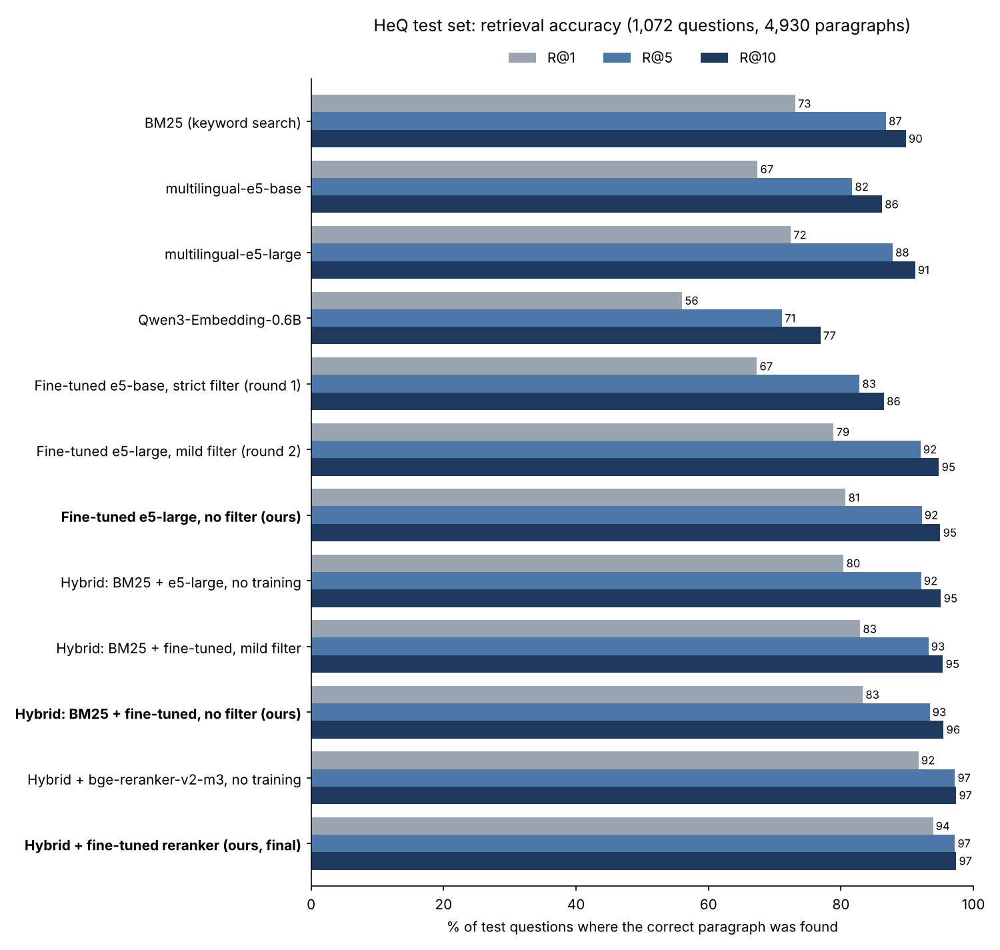

# Hebrew Semantic Search and Question Answering

**Live demo:** [Hugging Face Space](SPACE_URL) · **Models:** [retriever](https://huggingface.co/ElyKok/hebrew-qa-retriever-e5-large-nofilter), [reranker](https://huggingface.co/ElyKok/hebrew-qa-reranker) · **Data and embeddings:** [hebrew-qa-retrieval-data](https://huggingface.co/datasets/ElyKok/hebrew-qa-retrieval-data)

A Hebrew question answering system: it takes a question in Hebrew, finds the paragraph that answers it, and extracts the answer. It has three stages, and I fine-tuned the two retrieval models:

1. **Hybrid search:** keyword search (BM25) plus a **fine-tuned embedding model**, combined with Reciprocal Rank Fusion, returns the top 20 candidates out of 4,930 paragraphs.
2. **Reranking:** a **fine-tuned cross-encoder** reads each question-paragraph pair and reorders the 20 candidates.
3. **Answer:** [DictaBERT-HeQ](https://huggingface.co/dicta-il/dictabert-heq) extracts the exact answer span from the top paragraphs. When a GPU is available, [DictaLM 3.0](https://huggingface.co/dicta-il/DictaLM-3.0-1.7B-Instruct) also writes a full-sentence answer (RAG).

The demo also lets visitors **upload their own Word, PDF or text document** and ask questions about it, with the same pipeline.

**Result:** the correct paragraph is ranked first for **93.9%** of test questions, up from 72.4% for the best off-the-shelf embedding model and 73.1% for keyword search.

<!-- Put a short GIF of the demo here -->

## Results

HeQ test set: 1,072 questions, each searched against all 4,930 paragraphs. R@k = % of questions whose correct paragraph is in the top k.

| Model | R@1 | R@5 | R@10 | MRR@10 | NDCG@10 |
|---|---|---|---|---|---|
| BM25 (keyword search) | 73.1 | 86.8 | 89.8 | 79.0 | 81.7 |
| multilingual-e5-base | 67.4 | 81.7 | 86.2 | 73.4 | 76.5 |
| multilingual-e5-large | 72.4 | 87.8 | 91.2 | 79.0 | 82.0 |
| Qwen3-Embedding-0.6B | 56.0 | 71.1 | 76.9 | 62.6 | 66.0 |
| Fine-tuned e5-base, strict filter (round 1) | 67.3 | 82.8 | 86.5 | 74.1 | 77.1 |
| Fine-tuned e5-large, mild filter (round 2) | 78.9 | 92.0 | 94.8 | 84.8 | 87.3 |
| **Fine-tuned e5-large, no filter (ours)** | **80.7** | **92.2** | **95.0** | **85.9** | **88.1** |
| Hybrid: BM25 + e5-large, no training | 80.4 | 92.1 | 95.1 | 85.5 | 87.8 |
| Hybrid: BM25 + fine-tuned, mild filter | 82.9 | 93.2 | 95.4 | 87.4 | 89.4 |
| **Hybrid: BM25 + fine-tuned, no filter (ours)** | **83.3** | **93.4** | **95.5** | **87.6** | **89.5** |
| Hybrid (ours) + bge-reranker-v2-m3, no training | 91.7 | 97.2 | 97.4 | 94.1 | 95.0 |
| **Hybrid (ours) + fine-tuned reranker (final system)** | **93.9** | **97.2** | **97.4** | **95.4** | **95.9** |

### Findings

- **Fine-tuning works, once the setup is right.** Fine-tuning e5-large raised R@1 from 72.4 to 80.7 (+8.3) and NDCG@10 from 82.0 to 88.1. The gain was largest on Geektime tech news (R@5 84.6 → 91.1), the source furthest from the model's original training data.
- **The first attempt barely helped, and the cause was in the data.** Fine-tuning e5-base improved NDCG@10 by only 0.6. Its hard-negative filter was so strict that it dropped about 40% of the training questions, and the loss flattened quickly, a sign the negatives were too easy. Round 2 kept every question, used 2 hard negatives per question with a milder filter, and switched to the larger model. Round 1 differs from round 2 in several ways, so its failure cannot be attributed to the filter alone.
- **Ablation: filtering "false negatives" hurt.** Hard-negative mining usually excludes candidates that might also contain the answer. A controlled run that changed only this step, with the same model, data, seed and settings, showed that removing the filter improved R@1 from 78.9 to 80.7. On HeQ, other paragraphs rarely contain the same answer, and the excluded paragraphs, those from the same article, turned out to be the most useful negatives: same topic, different detail. This is a single run, so part of the 1.8-point gap may be noise, but the no-filter model is ahead on every metric.
- **Keyword search is a strong baseline on HeQ.** BM25 beats e5-large at R@1, because HeQ questions were written by annotators looking at the paragraph and often reuse its exact wording.
- **Hybrid search gives the best results.** Combining BM25 with the embedding model through Reciprocal Rank Fusion beats either alone, because they fail on different questions. For example, the question with the biggest drop after fine-tuning (rank 1 → 15) copies a phrase from its paragraph almost word for word, which is exactly the case BM25 handles well. Inside the hybrid, the gap between the filtered and unfiltered models shrinks to 0.4 points.
- **The reranker gives the biggest single gain.** Even without training, `bge-reranker-v2-m3` lifts R@1 from 83.3 to 91.7, because it reads the question and the paragraph together instead of comparing two compressed vectors. Fine-tuning it on HeQ adds another 2.2 points, to 93.9. The reranker can only reorder the top 20 candidates, which contain the correct paragraph for 97.4% of questions, so that is the ceiling.
- **With a strong reranker, the first stage matters mostly for recall.** On top of the untrained hybrid, the fine-tuned reranker reaches almost the same R@1 (93.8 vs 93.9). The fine-tuned retriever's contribution shows up in how often the correct paragraph reaches the top 20 (96.8% → 97.4%), and in R@5 (96.6 → 97.2).
- **Qwen3-Embedding-0.6B underperformed** on this task, also in full precision, so its low score is not a precision artifact.

### Limitations

HeQ questions share more wording with their paragraphs than real user queries do, which favors keyword search and makes the task easier than open search. The model is trained and tested on the same two sources, so gains on other kinds of Hebrew text are likely smaller. Like any vector search, the system always returns the closest paragraphs, even when the corpus has no answer; a low reranker score is the signal that it does not know.

## How it works

1. **Data.** [HeQ](https://github.com/NNLP-IL/Hebrew-Question-Answering-Dataset) has about 30K crowdsourced questions on paragraphs from Hebrew Wikipedia and Geektime. I kept the answerable questions (19,654 train / 1,058 val / 1,072 test) and pooled all 4,930 paragraphs into one search corpus. The official splits are disjoint by article, so test topics are never seen in training.
2. **Hard negative mining.** For every training question, the untrained e5-large retrieves the most similar training paragraphs, and two of the top 15 (other than the correct one) become hard negatives.
3. **Fine-tuning.** `multilingual-e5-large` trained for one epoch with `CachedMultipleNegativesRankingLoss`: in-batch negatives plus the hard negatives, batch size 64 on a single T4 through gradient caching, with a no-duplicates batch sampler since several questions share each paragraph.
4. **Hybrid search.** Each paragraph gets 1/(60 + its BM25 rank) + 1/(60 + its embedding rank).
5. **Reranker.** `BAAI/bge-reranker-v2-m3` fine-tuned with `BinaryCrossEntropyLoss` on 78,616 pairs: for each training question, its correct paragraph (label 1) and 3 hard negatives (label 0) from the top 20 of the hybrid search, with the positives weighted x3 to balance the classes. One epoch on two T4 GPUs in parallel (PyTorch DDP via `torchrun`), 65 minutes.
6. **Answer extraction.** DictaBERT-HeQ, a reading-comprehension model trained on HeQ, scores every token of the top 3 paragraphs as a possible start and end of the answer, and the best span is shown with its confidence. Optionally, DictaLM 3.0 writes a full answer from the same paragraphs on the GPU.
7. **Your own document.** An uploaded document is split into passages of about 150 words, the size of HeQ paragraphs, and indexed in memory with both embedding models, so the demo can compare all three retrieval methods on it. Nothing is stored after the session ends.

## Project structure

The experiments ran in four notebooks, in this order. The badges open the original runs, with all their outputs, on the platform where each one ran.

| File | Purpose | Original run |
|---|---|---|
| `hebrew_qa_retrieval.ipynb` | Round 1: data, baselines, fine-tuning e5-base, evaluation |  |
| `round2_e5_large.ipynb` | Round 2: fine-tuning e5-large with a mild filter, hybrid search |  |
| `ablation_no_filter.ipynb` | The ablation: the same training without the false-negative filter (the final retriever) |  |
| `reranker_kaggle.ipynb` | Fine-tuning and evaluating the reranker on two GPUs |  |
| `space/app.py` | The Gradio demo: BM25, the untrained model and the full system side by side, answer extraction, and search in an uploaded document |
| `space/requirements.txt` | Dependencies for the demo |
| `space/results_all.csv` | The results table shown in the demo |

## Running it

1. Open a notebook with the badge in the table above, choose a T4 GPU (two T4s on Kaggle for the reranker) and run all cells. Each takes about 1 to 1.5 hours, mostly training. The later notebooks load earlier results from the Hugging Face dataset, and the Kaggle ones read a Hugging Face token from a Kaggle secret named `HF_TOKEN`.
2. Create a Gradio Space with ZeroGPU hardware, upload the three files from `space/`, and set `USER` in `app.py` to your Hugging Face username. Search, reranking and answer extraction run on the CPU; only the optional DictaLM answer needs the GPU.

## Tech stack

Python · PyTorch (DDP) · Sentence-Transformers · Hugging Face Transformers · BM25 · Hybrid search (RRF) · Cross-encoder reranking · Extractive QA · RAG · Gradio · Hugging Face Hub and ZeroGPU

## Credits

HeQ was created by Webiks for MAFAT and is released under CC BY 4.0. DictaBERT-HeQ and DictaLM are by [Dicta](https://dicta.org.il).
